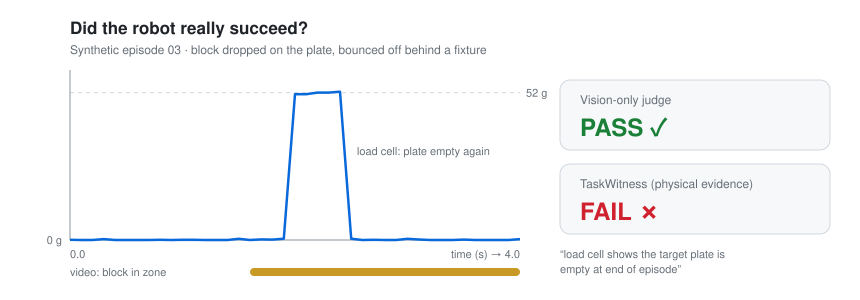

<div align="center">

# 🔍 TaskWitness

### Proof beyond perception.

**Don't trust the robot's claim. Verify what happened.**

[](https://github.com/TaskWitness/taskwitness/actions/workflows/ci.yml)
[](LICENSE)
[](pyproject.toml)


[简体中文](README.md) · **English**

[Quickstart](#-3-minute-quickstart) · [How it works](#️-how-it-works) · [Roadmap](#️-roadmap) · [Contributing](#-contributing)



<sub>Synthetic episode <code>03_bounced_off</code>, rendered from <code>examples/synthetic</code>. Not a real-robot measurement.</sub>

</div>

---

## 💡 Why TaskWitness?

Robot policies, VLAs and vision-based success detectors increasingly say *"task complete"*. But a camera can be fooled: the gripper still holds the block, the block bounced off, the tracker froze on the last good frame.

**TaskWitness is an independent, sensor-grounded verification layer for Physical AI.** It sits *outside* the robot policy, weighs physical sensor evidence first and video second, and returns a verdict you can audit.

| | Vision-only judge | **TaskWitness** |
| --- | --- | --- |
| Primary evidence | Pixels | **Physical sensors** |
| Trusts the robot's self-report? | Often | **Never** |
| When evidence is missing | Guesses | **Says `UNKNOWN`** |
| Output | A score | **Verdict + evidence bundle** |
| Reproducible & tamper-evident | Rarely | **Yes (SHA-256)** |

> TaskWitness does **not** control robots, train policies, or replace LeRobot, ROS 2 or other evaluation frameworks. It plugs into them as an external result judge.

---

## 🚀 3-minute quickstart

No robot. No GPU. No dependencies beyond Python 3.10+.

```bash
git clone https://github.com/TaskWitness/taskwitness
cd taskwitness
python -m venv .venv
source .venv/bin/activate        # Windows: .venv\Scripts\activate
pip install -e .

taskwitness batch examples/synthetic --out report.json
```

```text
PASS     01_clean_success.json  (stable load on the target plate matches the object's mass)
FAIL     02_not_released.json  (only part of the object's weight is on the plate while the gripper is still closed: object not released)
FAIL     03_bounced_off.json  (load cell shows the target plate is empty at end of episode)
UNKNOWN  04_sensor_dropout.json  (no usable load-cell evidence; refusing to judge from video alone)
UNKNOWN  05_evidence_conflict.json  (load matches the object but video places it outside the zone; evidence conflict)
5 episodes: 1 PASS, 2 FAIL, 2 UNKNOWN; 0/5 labeled episodes disagree with their label
```

| Episode | Scenario | Vision-only | TaskWitness |
| --- | --- | --- | --- |
| 01 | Block placed and released cleanly | PASS | **PASS** |
| 02 | Block touches the plate but the gripper never opens | PASS | **FAIL** |
| 03 | Block bounces off behind a fixture; the video tracker stays locked on the zone | PASS | **FAIL** |
| 04 | Load-cell stream drops before the placement | PASS | **UNKNOWN** |
| 05 | Weight is right, but the camera sees the block outside the zone | FAIL | **UNKNOWN** |

👉 In **02** and **03**, a video-only judge says **PASS**. Physical evidence says **FAIL**.

Verify one episode and check its evidence bundle:

```bash
taskwitness verify examples/synthetic/02_not_released.json --out bundle.json
taskwitness check bundle.json --episode examples/synthetic/02_not_released.json
```

| Exit code | `0` | `1` | `2` | `3` |
| --- | --- | --- | --- | --- |
| Meaning | PASS | FAIL | UNKNOWN | bad input |

Drop it straight into CI or an evaluation loop.

---

## ⚙️ How it works

```text
 robot / VLA / agent ──► actions · video · self-reported "success"
                                   │
                          TaskWitness Core
       ┌────────────────┬──────────┴───────┬─────────────────┐
  Load-cell oracle  Gripper oracle    Video oracle      (more oracles later)
       └────────────────┴────────┬─────────┴─────────────────┘
                          Evidence fusion
                                 │
            PASS / FAIL / UNKNOWN  +  evidence bundle
     timeline · measurements · reasons · config · SHA-256 digests
```

**Three rules**

1. 🏋️ **Physics first.** The load cell under the target zone is authoritative. Video can veto a PASS, never create one.
2. ❓ **`UNKNOWN` is a feature.** Missing, unsettled or conflicting evidence yields `UNKNOWN` instead of a guess.
3. 🙈 **Blind to claims and labels.** The robot's self-report and ground-truth labels are stripped before judging, and used only afterwards for comparison.

<details>
<summary><b>Full PlaceOracle decision table</b></summary>

| Load cell (final settle window) | Gripper | Video | Verdict |
| --- | --- | --- | --- |
| no / too few samples | any | any | UNKNOWN |
| not settled | any | any | UNKNOWN |
| heavier than the object | any | any | UNKNOWN |
| empty | any | any | **FAIL** |
| partial weight | closed | any | **FAIL** (not released) |
| partial weight | open / unknown | any | UNKNOWN |
| matches object | any | out of zone | UNKNOWN (conflict) |
| matches object | closed | in zone / unavailable | UNKNOWN (may be pressing) |
| matches object | open / unknown | in zone / unavailable | **PASS** |

All thresholds live in `PlaceOracleConfig` and are recorded in every bundle.

</details>

📄 Formats: [docs/EVIDENCE_SPEC.md](docs/EVIDENCE_SPEC.md) · 🏗️ Design: [docs/ARCHITECTURE.md](docs/ARCHITECTURE.md)

---

## 📦 What's in v0.1

**Honest status: pre-alpha.** Every example in this repo is synthetic; no result here is yet a measurement from a real robot, camera or load cell.

| ✅ Available now | 🛠️ Not built yet |
| --- | --- |
| `PlaceOracle`: place object in target zone | Video inference from raw frames |
| Load cell + gripper + video fusion with explicit `UNKNOWN` | Sensor drivers & hardware adapters |
| Deterministic, tamper-evident evidence bundles | Calibration tooling |
| CLI: `verify` · `batch` · `check` | LeRobot & other framework plugins |
| 5 synthetic episodes + test suite + CI | `ButtonPressOracle` (v0.2) |

---

## 🗺️ Roadmap

| Phase | Focus | Done when |
| --- | --- | --- |
| **D1–7** | Synthetic demo, CLI, tests ✅; public videos with human labels | A stranger runs it unaided; 5+ target developers give feedback |
| **D8–30** | Phone camera + load cell, 200+ independently labeled trials | Does fusion cut false passes under pre-registered conditions? |
| **D31–60** | WitnessNode sensor box, one framework plugin, community robots (e.g. SO-101) | 2+ external real-robot setups run it |
| **D61–90** | Publish real-data results, first WitnessBench release | 1+ independent external reproduction |

Details: [docs/ROADMAP_90_DAYS.zh-CN.md](docs/ROADMAP_90_DAYS.zh-CN.md) (Chinese) · Hardware notes: [hardware/README.md](hardware/README.md)

---

## 🧩 Project family

| Name | What | Status |
| --- | --- | --- |
| **TaskWitness Core** | Open-source verification SDK | v0.1 (this repo) |
| **WitnessNode** | Low-cost sensor box | design notes |
| **WitnessKit** | Physical experiment kit | planned |
| **WitnessBench** | Community test dataset | planned |

**Open source, for real:** Apache-2.0. Oracles, sensor guides, fusion logic, local reports, evidence export and `UNKNOWN` handling are and will stay open.

---

## 🤝 Contributing

The most valuable contribution right now is **a real experiment**: labeled place attempts with load-cell data, *especially* cases where TaskWitness gets it wrong.

Have a robot arm, a load cell, or just a phone and a kitchen scale? Open an issue.

See [CONTRIBUTING.md](CONTRIBUTING.md).

---

<div align="center">

**When AI says success, who checks reality?**

<sub>Licensed under <a href="LICENSE">Apache-2.0</a>.</sub>

</div>
