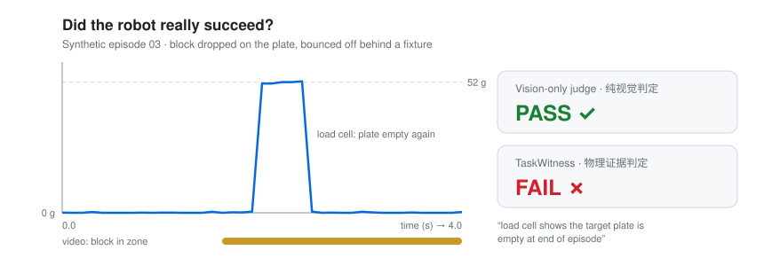

<div align="center">

# 🔍 TaskWitness

### Proof beyond perception. · 超越视觉的物理证据

**Don't trust the robot's claim. Verify what happened.**<br>
**不要轻信机器人的自我报告，去验证真实发生了什么。**

[](https://github.com/TaskWitness/taskwitness/actions/workflows/ci.yml)
[](LICENSE)
[](pyproject.toml)


[Quickstart · 快速开始](#-3-minute-quickstart--3-分钟体验) ·
[How it works · 工作原理](#-how-it-works--工作原理) ·
[Roadmap · 路线图](#-roadmap--路线图) ·
[Contributing · 参与贡献](#-contributing--参与贡献)



<sub>Synthetic episode <code>03_bounced_off</code>, rendered from <code>examples/synthetic</code>. Not a real-robot measurement. · 图中为合成样例，并非真实机器人数据。</sub>

</div>

---

## 💡 Why TaskWitness? · 为什么需要 TaskWitness？

Robot policies, VLAs and vision-based success detectors increasingly say *"task complete"*. But a camera can be fooled: the gripper still holds the block, the block bounced off, the tracker froze on the last good frame.

**TaskWitness is an independent, sensor-grounded verification layer for Physical AI.** It sits *outside* the robot policy, weighs physical sensor evidence first and video second, and returns a verdict you can audit.

机器人策略、VLA 和视觉成功检测器越来越频繁地报告“任务完成”。但相机会被骗：夹爪其实没松开、物体弹出了目标区、跟踪器停在了最后一帧。

**TaskWitness 是面向 Physical AI 的独立结果验证层。** 它独立于机器人策略，以物理传感器证据为主、视频为辅，给出可审计的判定。

| | Vision-only judge · 纯视觉判定 | **TaskWitness** |
| --- | --- | --- |
| Primary evidence · 主要依据 | Pixels · 画面 | **Physical sensors** · 物理传感器 |
| Trusts the robot's self-report? · 采信机器人自报？ | Often · 常常 | **Never** · 从不 |
| When evidence is missing · 证据不足时 | Guesses · 猜测 | **Says `UNKNOWN`** · 明确输出 UNKNOWN |
| Output · 输出 | A score · 分数 | **Verdict + evidence bundle** · 判定 + 证据包 |
| Reproducible & tamper-evident · 可复现、防篡改 | Rarely · 很少 | **Yes, SHA-256** · 是 |

> TaskWitness does **not** control robots, train policies, or replace LeRobot, ROS 2 or other evaluation frameworks. It plugs into them as an external result judge.
>
> TaskWitness **不负责**机器人控制、不训练策略，也不取代 LeRobot、ROS 2 等评测框架，而是作为外部结果判定器接入它们。

---

## 🚀 3-minute quickstart · 3 分钟体验

No robot. No GPU. No dependencies beyond Python 3.10+.<br>
不需要机器人，不需要 GPU，除 Python 3.10+ 外零依赖。

```bash
git clone https://github.com/TaskWitness/taskwitness
cd taskwitness
python -m venv .venv
source .venv/bin/activate        # Windows: .venv\Scripts\activate
pip install -e .

taskwitness batch examples/synthetic --out report.json
```

```text
PASS     01_clean_success.json  (stable load on the target plate matches the object's mass)
FAIL     02_not_released.json  (only part of the object's weight is on the plate while the gripper is still closed: object not released)
FAIL     03_bounced_off.json  (load cell shows the target plate is empty at end of episode)
UNKNOWN  04_sensor_dropout.json  (no usable load-cell evidence; refusing to judge from video alone)
UNKNOWN  05_evidence_conflict.json  (load matches the object but video places it outside the zone; evidence conflict)
5 episodes: 1 PASS, 2 FAIL, 2 UNKNOWN; 0/5 labeled episodes disagree with their label
```

👉 In **02** and **03**, a video-only judge says **PASS**. Physical evidence says **FAIL**.<br>
👉 在 **02** 和 **03** 中，纯视觉判定为 **PASS**，物理证据显示 **FAIL**。

Verify one episode and check its evidence bundle · 验证单个样例并检查证据包：

```bash
taskwitness verify examples/synthetic/02_not_released.json --out bundle.json
taskwitness check bundle.json --episode examples/synthetic/02_not_released.json
```

| Exit code · 退出码 | `0` | `1` | `2` | `3` |
| --- | --- | --- | --- | --- |
| Meaning · 含义 | PASS | FAIL | UNKNOWN | bad input · 输入错误 |

Drop it straight into CI or an evaluation loop. · 可直接用于 CI 或评测循环。

---

## ⚙️ How it works · 工作原理

```text
 robot / VLA / agent ──► actions · video · self-reported "success"
                                   │
                          TaskWitness Core
       ┌────────────────┬──────────┴───────┬─────────────────┐
  Load-cell oracle  Gripper oracle    Video oracle      (more oracles later)
   称重证据           夹爪状态           视频证据
       └────────────────┴────────┬─────────┴─────────────────┘
                         Evidence fusion · 证据融合
                                 │
          PASS / FAIL / UNKNOWN  +  evidence bundle · 证据包
     timeline · measurements · reasons · config · SHA-256 digests
```

**Three rules · 三条原则**

1. 🏋️ **Physics first.** The load cell under the target zone is authoritative. Video can veto a PASS, never create one.<br>
   **物理优先。** 目标区下方的称重传感器是主要依据；视频只能否决 PASS，不能单独产生 PASS。
2. ❓ **`UNKNOWN` is a feature.** Missing, unsettled or conflicting evidence yields `UNKNOWN` instead of a guess.<br>
   **UNKNOWN 是功能。** 证据缺失、读数未稳定或证据冲突时，拒绝猜测。
3. 🙈 **Blind to claims and labels.** The robot's self-report and ground-truth labels are stripped before judging, and used only afterwards for comparison.<br>
   **不看自报与标签。** 机器人自报结果和人工标签在判定前被剔除，仅在判定后用于对照。

<details>
<summary><b>Full PlaceOracle decision table · 完整判定表</b></summary>

| Load cell, final settle window · 称重（最终稳定窗口） | Gripper · 夹爪 | Video · 视频 | Verdict · 判定 |
| --- | --- | --- | --- |
| no / too few samples · 无数据或样本不足 | any | any | UNKNOWN |
| not settled · 未稳定 | any | any | UNKNOWN |
| heavier than the object · 超过物体重量 | any | any | UNKNOWN |
| empty · 空载 | any | any | **FAIL** |
| partial weight · 部分重量 | closed · 闭合 | any | **FAIL** (not released · 未释放) |
| partial weight · 部分重量 | open / unknown | any | UNKNOWN |
| matches object · 与物体一致 | any | out of zone · 区外 | UNKNOWN (conflict · 冲突) |
| matches object · 与物体一致 | closed · 闭合 | in zone / unavailable | UNKNOWN (may be pressing · 可能在按压) |
| matches object · 与物体一致 | open / unknown | in zone / unavailable | **PASS** |

All thresholds live in `PlaceOracleConfig` and are recorded in every bundle. · 所有阈值定义在 `PlaceOracleConfig` 中，并完整写入每个证据包。

</details>

📄 Formats · 数据格式：[docs/EVIDENCE_SPEC.md](docs/EVIDENCE_SPEC.md) · 🏗️ Design · 架构：[docs/ARCHITECTURE.md](docs/ARCHITECTURE.md)

---

## 📦 What's in v0.1 · 当前状态

**Honest status: pre-alpha.** Every example in this repo is synthetic; no result here is yet a measurement from a real robot, camera or load cell.<br>
**如实说明：pre-alpha。** 仓库中的样例全部为合成数据，尚无真实机器人、相机或称重传感器的测量结果。

| ✅ Available now · 已实现 | 🛠️ Not built yet · 尚未实现 |
| --- | --- |
| `PlaceOracle`: place object in target zone · 物体放置验证 | Video inference from raw frames · 原始视频推断 |
| Load cell + gripper + video fusion with explicit `UNKNOWN` · 证据融合 | Sensor drivers & hardware adapters · 传感器驱动 |
| Deterministic, tamper-evident evidence bundles · 确定性、防篡改证据包 | Calibration tooling · 校准工具 |
| CLI: `verify` · `batch` · `check` | LeRobot & other framework plugins · 评测框架插件 |
| 5 synthetic episodes + test suite + CI · 合成样例、测试与 CI | `ButtonPressOracle` (v0.2) |

---

## 🗺️ Roadmap · 路线图

| Phase · 阶段 | Focus · 重点 | Done when · 验收 |
| --- | --- | --- |
| **D1–7** | Synthetic demo, CLI, tests ✅ · public videos with human labels<br>合成演示、CLI、测试 ✅ · 公开视频人工标注 | A stranger runs it unaided; 5+ target developers give feedback<br>陌生开发者独立跑通；≥5 位目标开发者反馈 |
| **D8–30** | Phone camera + load cell, 200+ independently labeled trials<br>手机 + 称重传感器，≥200 次独立标注实验 | Does fusion cut false passes under pre-registered conditions?<br>预设条件下融合能否显著降低误判通过 |
| **D31–60** | WitnessNode sensor box, one framework plugin, community robots (e.g. SO-101)<br>传感器盒、评测框架插件、社区机器人 | 2+ external real-robot setups run it<br>≥2 个外部真实机器人环境 |
| **D61–90** | Publish real-data results, first WitnessBench release<br>公开真实实验结果，发布 WitnessBench 首版 | 1+ independent external reproduction<br>≥1 份外部独立复现 |

Details · 详情：[docs/ROADMAP_90_DAYS.zh-CN.md](docs/ROADMAP_90_DAYS.zh-CN.md) · Hardware notes · 硬件说明：[hardware/README.md](hardware/README.md)

---

## 🧩 Project family · 项目家族

| Name · 名称 | What · 内容 | Status · 状态 |
| --- | --- | --- |
| **TaskWitness Core** | Open-source verification SDK · 开源验证 SDK | v0.1 (this repo · 本仓库) |
| **WitnessNode** | Low-cost sensor box · 低成本传感器盒 | design notes · 设计草案 |
| **WitnessKit** | Physical experiment kit · 真实物理实验工具包 | planned · 规划中 |
| **WitnessBench** | Community test dataset · 社区测试数据集 | planned · 规划中 |

**Open source, for real · 真正的开源：** Apache-2.0. Oracles, sensor guides, fusion logic, local reports, evidence export and `UNKNOWN` handling are and will stay open.<br>
Oracle、传感器方案、融合算法、本地报告、证据导出和 UNKNOWN 逻辑现在开源，将来也保持开源。

---

## 🤝 Contributing · 参与贡献

The most valuable contribution right now is **a real experiment**: labeled place attempts with load-cell data, *especially* cases where TaskWitness gets it wrong.<br>
现在最有价值的贡献是**一次真实实验**：带称重数据和人工标签的放置任务记录，**尤其是** TaskWitness 判错的案例。

Have a robot arm, a load cell, or just a phone and a kitchen scale? Open an issue. · 有机械臂、称重传感器，甚至只有手机和厨房秤？欢迎提 Issue。

See [CONTRIBUTING.md](CONTRIBUTING.md) · 参见贡献指南。

---

<div align="center">

**When AI says success, who checks reality?**<br>
**当 AI 说“成功”时，谁来核实现实？**

<sub>Licensed under <a href="LICENSE">Apache-2.0</a>.</sub>

</div>
