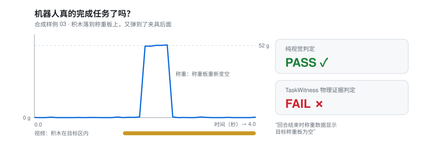

<div align="center">

# 🔍 TaskWitness

### 超越视觉的物理证据

**不要轻信机器人的自我报告，去验证真实发生了什么。**

[](https://github.com/TaskWitness/taskwitness/actions/workflows/ci.yml)
[](LICENSE)
[](pyproject.toml)


**简体中文** · [English](README.en.md)

[快速开始](#-3-分钟体验) · [工作原理](#️-工作原理) · [工具链](#️-从真实设备到可信结果) · [研究依据](#-研究依据) · [路线图](#️-路线图)



<sub>图中为合成样例 <code>03_bounced_off</code>，由 <code>examples/synthetic</code> 中的数据绘制，并非真实机器人测量结果。</sub>

</div>

---

## 💡 为什么需要 TaskWitness？

机器人策略、VLA 和视觉成功检测器越来越频繁地报告“任务完成”。但相机会被骗：夹爪其实没松开、物体弹出了目标区、工具只是悬停在按钮上方。最新研究也印证了这一点：在 FailBench 上，最好的 VLM 判定器平均平衡准确率只有 0.77，并且在证据模糊时系统性地偏向判定“成功”（[研究笔记](docs/RESEARCH.md)）。

**TaskWitness 是面向 Physical AI 的独立结果验证层。** 它独立于机器人策略，以物理传感器证据为主、视频为辅，给出可审计的判定，并提供检验其他判定器所需的统计工具。

| | 纯视觉判定 | **TaskWitness** |
| --- | --- | --- |
| 主要依据 | 画面 | **物理传感器** |
| 采信机器人自报结果？ | 常常 | **从不** |
| 证据不足时 | 猜测 | **明确输出 `UNKNOWN`** |
| 输出 | 一个分数 | **判定 + 证据包** |
| 可复现、防篡改 | 很少 | **是（SHA-256，可选签名）** |

> TaskWitness **不负责**机器人控制、不训练策略，也不取代 LeRobot、ROS 2、Inspect Robots 等评测框架，而是作为外部结果判定器接入它们。

---

## 🚀 3 分钟体验

不需要机器人，不需要 GPU；核心功能除 Python 3.10+ 外零依赖。

```bash
git clone https://github.com/TaskWitness/taskwitness
cd taskwitness
python -m venv .venv
source .venv/bin/activate        # Windows：.venv\Scripts\activate
pip install -e .

taskwitness batch examples/synthetic --out report.json
taskwitness batch examples/synthetic_button --out report-button.json
```

```text
PASS     01_clean_success.json  (stable load on the target plate matches the object's mass)
FAIL     02_not_released.json  (only part of the object's weight is on the plate while the gripper is still closed: object not released)
FAIL     03_bounced_off.json  (load cell shows the target plate is empty at end of episode)
UNKNOWN  04_sensor_dropout.json  (no usable load-cell evidence; refusing to judge from video alone)
UNKNOWN  05_evidence_conflict.json  (load matches the object but video places it outside the zone; evidence conflict)
5 episodes: 1 PASS, 2 FAIL, 2 UNKNOWN; 0/5 labeled episodes disagree with their label
```

| 样例 | 场景 | 纯视觉 | TaskWitness |
| --- | --- | --- | --- |
| 01 | 正常放下并松开夹爪 | PASS | **PASS** |
| 02 | 积木碰到称重板，但夹爪始终没有松开 | PASS | **FAIL** |
| 03 | 积木落下后弹到夹具后面，视频跟踪器卡在目标区 | PASS | **FAIL** |
| 04 | 放置前称重数据流中断 | PASS | **UNKNOWN** |
| 05 | 称重正确，但相机看到积木在目标区外 | FAIL | **UNKNOWN** |
| b01 | 按下按钮 200 毫秒，接触瞬间有抖动 | PASS | **PASS** |
| b02 | 工具悬停在按钮上方，但没有按下去 | PASS | **FAIL** |
| b03 | 轻轻擦过按钮，接触仅 30 毫秒 | PASS | **FAIL** |
| b04 | 录制结束时仍按着按钮 | PASS | **UNKNOWN** |
| b05 | 工具到达前开关数据流中断 | PASS | **UNKNOWN** |
| b06 | 开关被触发，但工具一直在桌子另一侧 | FAIL | **UNKNOWN** |

👉 在 02、03、b02、b03 四个样例中，纯视觉判定为 **PASS**，物理证据显示 **FAIL**。

**统计上要诚实：** 只有 4 个成对差异时，精确 McNemar 检验给出 p = 0.0625，任意时刻有效的序贯检验给出 p ≈ 0.17，都不显著。工具会如实报告这一点，而不是夸大结论：

```bash
taskwitness evaluate examples/synthetic examples/synthetic_button
```

验证单个样例并检查证据包：

```bash
taskwitness verify examples/synthetic/02_not_released.json --out bundle.json
taskwitness check bundle.json --episode examples/synthetic/02_not_released.json
```

`verify` 退出码：PASS=0、FAIL=1、UNKNOWN=2、输入错误=3，可直接用于 CI 或评测循环。

---

## ⚙️ 工作原理

```text
 机器人 / VLA / 智能体 ──► 动作 · 视频 · 自报“成功”
                                │
                        TaskWitness Core
       ┌───────────────┬────────┴────────┬────────────────┐
   称重 / 按钮触点       夹爪状态          视频证据        （更多 Oracle）
       └───────────────┴────────┬────────┴────────────────┘
                             证据融合
                                │
             PASS / FAIL / UNKNOWN  +  证据包
        时间线 · 测量数据 · 判定理由 · 阈值配置 · SHA-256 摘要
```

**三条原则**

1. 🏋️ **物理优先。** 称重传感器或按钮自身的触点是主要依据；视频只能否决 PASS，不能单独产生 PASS。
2. ❓ **UNKNOWN 是功能。** 证据缺失、读数未稳定、存在观测缺口或证据冲突时，拒绝猜测。
3. 🙈 **不看自报与标签。** 机器人自报结果和人工标签在判定前被剔除，仅在判定后用于对照。

<details>
<summary><b>PlaceOracle 完整判定表</b></summary>

| 称重（最终稳定窗口） | 夹爪 | 视频 | 判定 |
| --- | --- | --- | --- |
| 物体过轻，无法与空板区分 | 任意 | 任意 | UNKNOWN |
| 回合开始时称重板读数就不为空（上一次的物体、清零错误） | 任意 | 任意 | UNKNOWN（无法把最终重量归于本次尝试） |
| 无数据或样本不足 | 任意 | 任意 | UNKNOWN |
| 读数未稳定 | 任意 | 任意 | UNKNOWN |
| 超过物体重量 | 任意 | 任意 | UNKNOWN |
| 空载 | 任意 | 任意 | **FAIL** |
| 部分重量 | 闭合 | 任意 | **FAIL**（未释放） |
| 部分重量 | 张开 / 未知 | 任意 | UNKNOWN |
| 与物体重量一致 | 任意 | 在目标区外 | UNKNOWN（证据冲突） |
| 与物体重量一致 | 闭合 | 在目标区内 / 无数据 | UNKNOWN（可能在按压） |
| 与物体重量一致 | 张开 / 未知 | 在目标区内 / 无数据 | **PASS** |

</details>

<details>
<summary><b>ButtonPressOracle 完整判定表</b></summary>

| 按钮触点 | 视频 | 判定 |
| --- | --- | --- |
| 无数据 | 任意 | UNKNOWN |
| 结束时仍按下 | 任意 | UNKNOWN（按压未完成） |
| 次数不足，且某段接触的时长在当前采样率下无法与最短按压时长比较 | 任意 | UNKNOWN（请提高开关采样率） |
| 次数不足且存在观测缺口 | 任意 | UNKNOWN（可能未被观测到） |
| 次数超过 `max_presses` | 任意 | **FAIL** |
| 没有按压或次数不足（全程有观测） | 任意 | **FAIL**（悬停或力度不够） |
| 达到要求的完整按压 | 工具从未出现在按钮处 | UNKNOWN（可能被其他东西按下） |
| 达到要求的完整按压 | 工具在按钮处 / 无数据 | **PASS** |

接触抖动会被合并。采样只能给出接触时长的上下界，只有保证不短于 `min_hold_s` 的接触才计为按压，保证短于它的不计，介于两者之间则 UNKNOWN。

</details>

所有阈值定义在配置中并完整写入每个证据包。📄 数据格式：[docs/EVIDENCE_SPEC.md](docs/EVIDENCE_SPEC.md) · 🏗️ 架构：[docs/ARCHITECTURE.md](docs/ARCHITECTURE.md)

---

## 🛠️ 从真实设备到可信结果

```
记录日志 ─► calibrate ─► track ─► ingest ─► verify / evaluate / audit / estimate ─► sign
```

| 命令 | 作用 |
| --- | --- |
| `calibrate load-cell` / `calibrate camera` | 称重去皮与标定（报告噪声和残差）；像素到称重板坐标的单应矩阵（报告重投影误差） |
| `calibrate thresholds` | 用已知正常的录像，通过保形预测（conformal prediction）给出稳定性 / 空载 / 质量容差阈值：新的正常窗口超出阈值的概率不超过 α |
| `track` | 在视频中跟踪有颜色的物体或标记，支持感兴趣区域（需 `[vision]`） |
| `ingest place` / `ingest button_press` | 把 `t_ms,value` 日志和跟踪结果转为 episode，记录每个源文件的 SHA-256 |
| `verify` / `batch` / `check` | 判定、批量判定、检查证据包完整性；均支持 `--config` 冻结阈值 |
| `evaluate` | 对照人工标签：条件 / 绝对漏判、误判失败、UNKNOWN 率（附 Wilson 区间）、审计覆盖率、按失败类型分层、精确 McNemar 检验，以及**任意时刻有效的序贯检验**（可随时查看、随时停止，错误率仍受控） |
| `audit` | 在同一批回合上审计外部判定器（Robometer、TOPReward、VLM、操作员）：平衡准确率、ROC-AUC、校准误差、成功偏差 |
| `estimate` | 成功率区间：仅用标签（Wilson 与有限样本）、预测增强推断（渐近与有限样本）。如实提示：判定器不够准、回合不够多时，预测增强区间反而比只用标签更宽 |
| `lerobot` | 把本地 LeRobot v3 数据集（例如从 Hugging Face 下载）按映射文件转成 TaskWitness episode：选取列作为传感器数据流，按片段拆分，读取人工标签，记录数据文件的 SHA-256（需 `[lerobot]`）；已在 REASSEMBLE 的 149 个回合、143 万帧上验证 |
| `simulate` | 生成带已知真值的物理仿真回合（放置 / 按钮），可调噪声、掉线、跟踪器失效、时钟偏差；见 [仿真研究](docs/SIMULATION.md) |
| `keygen` / `sign` / `verify-signature` | 证据包 Ed25519 签名（需 `[sign]`） |

完整操作规程见 [实验指南](docs/EXPERIMENT_GUIDE.md)。

```bash
pip install -e '.[vision]'    # 视频跟踪：numpy + OpenCV
pip install -e '.[sign]'      # 签名：cryptography
pip install -e '.[inspect]'   # Inspect Robots 集成
pip install -e '.[lerobot]'   # 读取 LeRobot v3 数据集：pyarrow
pip install -e '.[all]'
```

### 🔌 集成：Inspect Robots

安装后，TaskWitness 会通过 entry point 向 [Inspect Robots](https://github.com/robocurve/inspect-robots) 注册 `taskwitness` 和 `taskwitness_unknown` 两个 scorer，并已在真实的 `inspect_robots.eval()` 流程中测试：

```python
Task(name="place_cube", scenes=[Scene(id="s1", instruction="put the cube on the plate",
     target=Target(kind="taskwitness.place", spec={"object": {"mass_g": 52.0}, "target_zone": {...}}))],
     scorer=["success_at_end", "taskwitness", "taskwitness_unknown"], max_steps=200)
```

具身（embodiment）只需在 `Observation.state` 中提供 `load_cell_g`（以及可选的 `gripper` / `button_pressed`），并设置 `state_time`。由于 Inspect Robots 按均值汇总分数，请同时运行两个 scorer，让 UNKNOWN 率与通过率一起出现。

---

## 📚 研究依据

TaskWitness 的设计依据近期文献（真实数据测试见 [docs/REAL_DATA.md](docs/REAL_DATA.md)）：FailBench（VLM 判定器的成功偏差）、覆盖偏移（策略越好，残留失败越难被视觉发现）、No Free Checker（验证器的可信度与可用性此消彼长）、LeRobot v0.6 的奖励模型（Robometer、TOPReward）、STEP / N-SCORE / SureSim / PPI（少量真实试验下的统计方法）。详见 [docs/RESEARCH.md](docs/RESEARCH.md)。

---

## 📦 当前状态：v0.5

**如实说明：pre-alpha。** 仓库中的样例全部为合成数据。唯一的真实数据检验是在公开的 REASSEMBLE 数据集上对 GraspOracle 做的（见 [docs/REAL_DATA.md](docs/REAL_DATA.md)）；称重传感器和按钮开关还没有任何真实测量结果。

| ✅ 已实现 | 🛠️ 尚未实现 |
| --- | --- |
| `PlaceOracle`、`ButtonPressOracle`、`GraspOracle` | WitnessNode 固件与实时串口记录器 |
| 严格的 episode 校验（拒绝 NaN / 无穷大，精确指出出错字段） | |
| 称重与相机校准、保形阈值校准、日志导入、颜色块视频跟踪 | 基于学习或 VLM 的视频检测器 |
| `evaluate` / `audit` / `estimate`：Wilson 区间、McNemar、序贯检验、有限样本区间 | 称重 / 按钮 Oracle 的真实硬件结果（目前没有公开数据集包含这些传感器） |
| 物理仿真器与仿真研究（`simulate`、`examples/simulation/study.py`） | |
| 在真实数据（REASSEMBLE）上测试 GraspOracle | |
| Inspect Robots scorer（已在真实评测流程中测试） | |
| 确定性、防篡改证据包与可选签名 | |
| LeRobot v3 数据集适配器（在真实数据集上验证，结果与独立脚本逐项一致） | |
| 185 项测试（含对统计保证的模拟验证）、CI | |

---

## 🗺️ 路线图

| 阶段 | 重点 | 验收 |
| --- | --- | --- |
| **D1–7** | 合成演示、命令行、测试 ✅；公开视频人工标注 | 陌生开发者独立跑通；≥5 位目标开发者反馈 |
| **D8–30** | 手机 + 称重传感器，≥200 次独立标注实验（工具链已就绪 ✅） | 预设条件下，融合方案能否显著降低误判通过 |
| **D31–60** | WitnessNode 传感器盒、评测框架插件（Inspect Robots ✅）、社区机器人（如 SO-101） | ≥2 个外部真实机器人环境运行实验 |
| **D61–90** | 公开真实实验结果，发布 WitnessBench 首版 | ≥1 份外部独立复现 |

详情：[docs/ROADMAP_90_DAYS.md](docs/ROADMAP_90_DAYS.md) · 硬件说明：[hardware/README.md](hardware/README.md) · 更新记录：[CHANGELOG.md](CHANGELOG.md)

---

## 🧩 项目家族

| 名称 | 内容 | 状态 |
| --- | --- | --- |
| **TaskWitness Core** | 开源验证 SDK | v0.5（本仓库） |
| **WitnessNode** | 低成本传感器盒 | 设计草案 |
| **WitnessKit** | 真实物理实验工具包 | 规划中 |
| **WitnessBench** | 社区测试数据集 | 规划中 |

**真正的开源：** 采用 Apache-2.0。Oracle、传感器方案、融合算法、统计工具、证据导出和 UNKNOWN 逻辑现在开源，将来也保持开源。

---

## 🤝 参与贡献

现在最有价值的贡献是**一次真实实验**：按[实验指南](docs/EXPERIMENT_GUIDE.md)采集、带称重数据和人工标签的放置任务记录，**尤其是** TaskWitness 判错的案例。

有机械臂、称重传感器，甚至只有手机和厨房秤？欢迎提 Issue。参见 [CONTRIBUTING.md](CONTRIBUTING.md)。

---

<div align="center">

**当 AI 说“成功”时，谁来核实现实？**

<sub>基于 <a href="LICENSE">Apache-2.0</a> 许可证发布。</sub>

</div>
